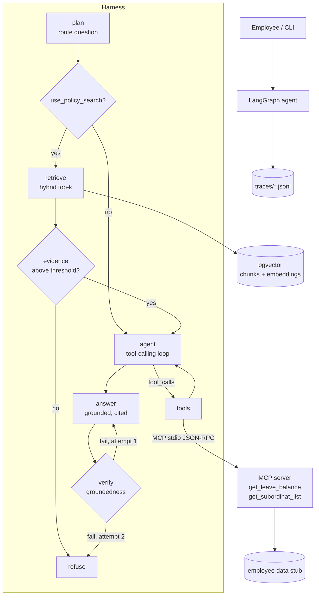

# Majoo HR Assistant — RAG + MCP take-home

Versi Bahasa Indonesia (ringkas) dari [`README.md`](README.md). Kalau ada
perbedaan, versi Inggris yang berlaku.

Chatbot HR internal untuk PT Majoo Teknologi Indonesia. Menjawab pertanyaan
karyawan dari korpus dokumen HR, memanggil tool HR lewat MCP saat pertanyaan
butuh data karyawan, dan menolak menjawab kalau dokumen tidak memuat
jawabannya.

```
CLI  ->  LangGraph agent  ->  hybrid retriever  ->  pgvector
                        \->  MCP client  ->  MCP server (stdio)  ->  HRIS stub
```

## 1. Arsitektur (Tugas 1)



Komponen yang terlibat end to end: CLI, agent LangGraph (plan, retrieve, agent,
tools, answer, verify, refuse), retriever hybrid, pgvector, MCP client, MCP
server, dan stub HRIS. Setiap node menulis span JSONL ke `traces/`.

### Justifikasi komponen

| Komponen | Pilihan | Alasan |
|---|---|---|
| Orkestrasi | LangGraph | Harness adalah deliverable-nya. Node bernama memberi trace per langkah dan batas langkah yang tegas; loop ReAct berbentuk string menyembunyikan keduanya. |
| LLM | Groq `openai/gpt-oss-120b` | Tool calling native dan latensi ~1-2 s. OpenRouter disiapkan sebagai fallback. Batas free tier per menit ditangani dengan backoff; batas per hari dengan rotasi kunci. |
| Embedding | Gemini `gemini-embedding-2`, 1536 dim | Korpus campur Bahasa Indonesia dan Inggris. Diuji pada korpus ini: pertanyaan yang cocok skor 0.69-0.82, yang di luar topik 0.61 — selisih inilah yang membuat gerbang penolakan bisa dipercaya. Dipotong ke 1536 dim (MRL) karena HNSW pgvector maksimal 2000 dim. |
| Vector store | pgvector (Postgres 16) | Satu database untuk vektor dan data relasional (join `employee_id` nanti), indeks HNSW cosine, tanpa service tambahan. Chroma/FAISS lebih cepat dimulai tapi tidak bertahan saat pindah ke production. |
| Retrieval | dense + lexical, digabung RRF | Pertanyaan HR mencampur parafrase ("boleh enggak cuti dipindah?") dengan istilah persis ("BPJS", "PPh 21"). Dense saja melewatkan istilah persis, lexical saja melewatkan parafrase. RRF tidak perlu tuning bobot. |
| Protokol tool | MCP over stdio | Diwajibkan kasus ini, dan memang batas yang benar: proses agent tidak punya jalur import ke lapisan data HR. |
| Konfigurasi | pydantic-settings | Satu sumber konfigurasi bertipe, ramah `.env`, gagal keras kalau nilainya salah. |
| Eval | Ragas + gate deterministik | Ragas mengukur kualitas jawaban; yang benar-benar menjadi gate rilis adalah cek deterministik (routing, refusal, sitasi). |

### Kapan RAG, kapan panggil tool

1. `plan` bertanya ke LLM: butuh dokumen kebijakan, data karyawan langsung,
   keduanya, atau tidak sama sekali. Output JSON dan divalidasi; kalau model
   mengembalikan sampah, default-nya "keduanya".
2. `retrieve` jalan hanya kalau dokumen kebijakan dibutuhkan.
3. `agent` memegang tool MCP. LLM memilih memanggil `get_leave_balance` atau
   `get_subordinat_list`; tidak ada jalur memanggil fungsi Python langsung,
   semua lewat JSON-RPC stdio.
4. `answer` menulis jawaban dari chunk yang diambil plus hasil tool.
5. `verify` membaca ulang draf terhadap bukti yang sama.

Contoh yang memakai dua jalur sekaligus:

> "Berapa sisa cuti EMP-001 dan bolehkah sisanya dipindah ke tahun depan?"

Trace: `plan` (keduanya true) -> `retrieve` (kebijakan carry over, similarity
0.8x) -> `agent` (`get_leave_balance({"employee_id": "EMP-001"})`) -> `tools`
-> `answer` -> `verify` (grounded). Jawabannya menggabungkan "9 hari tersisa"
dengan aturan "maksimal 5 hari, dipakai sebelum 30 Juni".

## 2. RAG pipeline (Tugas 2)

| Tahap | Implementasi |
|---|---|
| Chunking | Heading-aware, 900 karakter, overlap 150. Satu chunk tidak pernah melintasi dua topik kebijakan. |
| Embedding | Gemini `gemini-embedding-2`, 1536 dim, batch 90 teks per request. Ada fallback embedder lokal deterministik supaya repo tetap bisa dijalankan tanpa API key. |
| Vector store | pgvector, kolom `vector(1536)`, indeks HNSW cosine + GIN untuk pencarian lexical. |
| Retrieval | Top-k=5, dense dan lexical digabung dengan Reciprocal Rank Fusion. |

Index diisi oleh `python -m scripts.ingest`: 70 dokumen -> 1800 chunk
terindeks (87 Majoo + 1713 GitLab). Hasil ingestion (chunk + vektor) **tidak**
di-commit; reviewer menjalankan ingest sendiri.

## 3. MCP server (Tugas 3)

`app/mcp_server/server.py`, FastMCP over stdio, dua tool:

| Tool | Perilaku |
|---|---|
| `get_leave_balance(employee_id)` | Sisa cuti tahunan, terpakai, dan sisa carry over. |
| `get_subordinat_list(employee_id)` | Daftar bawahan langsung beserta jabatan dan departemen. |

Keduanya membaca `app/mcp_server/data/employees.json` (stub HRIS). ID yang tidak
dikenal mengembalikan `found: false`, bukan exception, supaya agent bisa
meminta ID yang benar alih-alih mengarang.

## 4. Agent, guardrail, dan Harness/Loop Engineering (Tugas 4)

| Aspek | Implementasi |
|---|---|
| Batas langkah | `MAX_STEPS=4`. `route_after_agent` berhenti memanggil tool saat budget habis dan memaksa jawaban; `recursion_limit` diisi dari angka yang sama. |
| Loop | `agent -> tools -> agent` hanya berulang selama model mengeluarkan tool call dan budget masih ada. |
| Koreksi diri | `verify` mengembalikan klaim yang tidak didukung; `answer` dijalankan ulang sekali dengan kritik itu, lalu `refuse`. Maksimal 2 percobaan. |
| Kegagalan tool | Error MCP muncul sebagai `ToolMessage` berstatus `error`; agent melihatnya dan bisa pulih atau menolak. |
| Guardrail "tidak tahu" | Tiga lapis: gerbang retrieval (cosine < `SIMILARITY_THRESHOLD`), kontrak prompt (kalimat penolakan baku), dan node `verify` (judge groundedness). Penolakan tidak pernah dikirim ke judge — penolakan tidak membuat klaim, jadi memeriksanya hanya membakar budget retry. |
| Observability | Tiap node menulis span JSONL: node, status, latensi, token, nama dan argumen tool, similarity tertinggi, verdict groundedness. `python -m app.cli trace <run_id>` memutar ulang. |
| Determinisme | `temperature=0` di semua panggilan. Test memakai LLM skrip, jadi jalur routing dan penolakan teruji tanpa jaringan. |

Satu use case Harness/Loop Engineering yang diterapkan: **loop dengan budget
langkah, koreksi diri terbatas, dan trace per node** — bukan loop bebas.
Kegagalan yang tidak bisa diperbaiki berhenti sebagai penolakan, bukan sebagai
jawaban karangan.

## 5. Menjalankan

Tiga perintah ke demo yang jalan (87 chunk first-party, ~2 menit embedding):

```bash
docker compose up -d
python -m scripts.ingest --prefix majo-hr
python -m app.cli ask "berapa sisa cuti EMP-001 dan boleh dipindah ke tahun depan?"
```

Setup lengkap: lihat `README.md` bagian 3. Persiapan minimum:

```bash
py -3.10 -m venv .venv
.venv\Scripts\python -m pip install -r requirements-dev.txt
copy .env.example .env      # isi GROQ_API_KEY dan GEMINI_API_KEY_1..N
pytest                      # 76 test offline, tanpa jaringan dan tanpa DB
```

Kalau tidak ada key Gemini, set `EMBEDDING_PROVIDER=local` untuk menjalankan
pipeline dengan embedder offline (kualitas jauh lebih rendah; hanya untuk
keterjalan repo).

## 6. Trade-off (Tugas 5)

- **Chunk 900 karakter, overlap 150.** Satu aturan plus pengecualiannya harus
  muat dalam satu chunk. Chunk 400-500 sedikit menaikkan context precision, tapi
  memisahkan "maksimal 5 hari" dari "harus dipakai sebelum 30 Juni".
- **pgvector, bukan Chroma/FAISS.** Chroma lebih cepat dimulai, tapi data
  karyawan sebaiknya satu Postgres dengan chunk-nya, dan HNSW pgvector adalah
  jalur production. Biayanya: Docker wajib jalan.
- **1536 dim, bukan 3072.** HNSW pgvector menolak vektor di atas 2000 dim.
  Truncation MRL kehilangan sedikit recall dan membeli kolom yang bisa diindeks.
- **`SIMILARITY_THRESHOLD=0.62`, dikalibrasi.** Pertanyaan yang cocok 0.69-0.82,
  yang di luar topik 0.61. Margin sisi negatif tipis (~0.01) — itu angka jujur
  untuk korpus sekecil ini, dan alasan threshold hanya lapis pertama dari tiga.
- **Retrieval dibatasi `SOURCE_SCOPE=majo-hr`.** Korpus berisi juga handbook
  GitLab (CC BY-SA 4.0) yang memuat kebijakan negara lain. Tanpa scope,
  "berapa lama cuti melahirkan?" dijawab dengan cuti 4 minggu ala Denmark,
  lengkap dengan sitasi. Scope memotong kontaminasi di query, bukan di prompt.
- **Hybrid, bukan dense saja.** Istilah kebijakan Indonesia sering token persis
  ("carry over", "BPJS", "PPh 21") yang diburamkan embedding.
- **Judge di dalam loop.** Satu panggilan model tambahan per jawaban, ~40% dari
  latensi. Diterima karena salah jawab soal hak cuti lebih buruk daripada lambat.
- **MCP, bukan pemanggilan fungsi langsung.** Menambah proses dan handshake,
  tapi lapisan data HR memang tidak boleh bisa di-import dari agent.

## 7. Evaluasi (Tugas 5)

`python -m eval.run_eval` menjalankan 25 pertanyaan berlabel
(`data/golden/qa.jsonl`) lewat graph penuh. Hasil terakhir ada di
`eval/report.md` (di-commit sebagai bukti):

| Metric | Nilai | Gate |
|---|---|---|
| `tool_routing_accuracy` | 1.00 | >= 0.85 |
| `refusal_accuracy` | 1.00 | >= 0.90 |
| `false_answer_rate` | 0.00 | dilaporkan |
| `citation_rate` | 1.00 (19 jawaban berbasis dokumen) | dilaporkan |
| Latensi p50 / p95 | 17.9 s / 22.4 s | dilaporkan |

Ragas pada subset 10 jawaban (`gpt-oss-20b` sebagai judge):
`faithfulness` 0.675 (10/10) dan `context_precision` 0.575 (10/10).
`answer_relevancy` terimplementasi tapi tidak masuk run ini karena butuh satu
embedding per sampel dan kuota harian Gemini sudah habis. Angka ini sinyal awal,
bukan ground truth: faithfulness 0.68 dan context precision 0.58 sama-sama
menunjuk pada jendela 5 chunk yang longgar — reranker atau jendela lebih sempit
adalah eksperimen berikutnya.

Yang akan ditambahkan untuk mengukur kualitas di production:

1. **Golden set dari tiket asli.** 25 pertanyaan hanya smoke test; ambil 6 bulan
   tiket People Operations, labeli 300, stratifikasi per area kebijakan.
2. **Eval retrieval terpisah.** Recall@5 dan MRR, supaya jawaban buruk bisa
   diatribusikan ke retrieval atau ke writer.
3. **Set adversarial.** Prompt injection di dalam dokumen, pertanyaan tentang
   karyawan yang tidak boleh dilihat, dan pertanyaan yang memancing menebak.
4. **Suite regresi per kebijakan.** Perubahan chunker cuti tidak boleh diam-diam
   merusak jawaban benefit.
5. **Sinyal online.** Rasio thumbs down, eskalasi ke manusia, dan "menolak padahal
   jawabannya ada", diambil dari trace.
6. **Budget biaya dan latensi.** Token per jawaban dari file trace, dilacak per
   rilis.

## 8. Batasan

- `employees.json` adalah stub, bukan HRIS nyata.
- Tidak ada autentikasi atau scoping per pengguna; deployment nyata wajib
  memastikan karyawan hanya bisa membaca cutinya sendiri dan bawahannya sendiri.
- Korpus = handbook publik GitLab (CC BY-SA 4.0, lihat
  `data/docs/ATTRIBUTION.md`) plus kebijakan Majoo sintetis; bukan dokumen Majoo
  yang sebenarnya.
- Single-turn; pertanyaan lanjutan seperti "kalau saya ambil minggu depan?"
  tidak diselesaikan terhadap giliran sebelumnya.
- 1713 dari 2179 chunk pihak ketiga terindeks; sisanya menunggu kuota embedding
  harian. Tidak memengaruhi eval karena retrieval dibatasi `majo-hr`.
