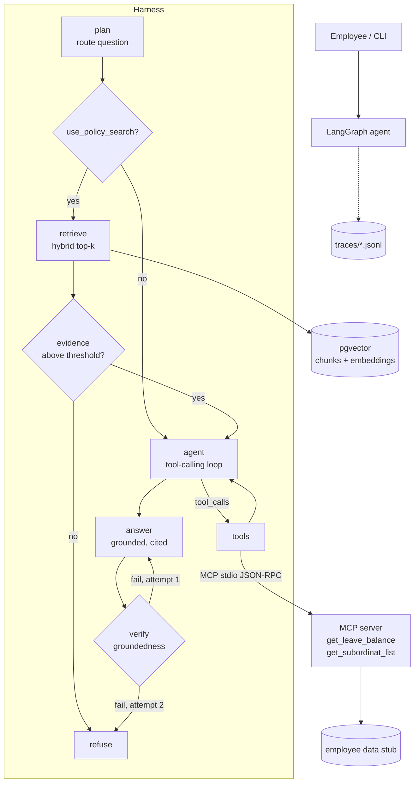

# Majoo HR Assistant: RAG + MCP take-home

Versi Bahasa Indonesia dari [`README.md`](README.md). Kalau ada perbedaan, versi
Inggris yang berlaku.

Chatbot HR internal untuk PT Majoo Teknologi Indonesia. Menjawab pertanyaan
karyawan dari dokumen HR, memanggil tool HR lewat MCP saat jawaban butuh data
karyawan, dan menolak menjawab saat dokumen tidak memuatnya.

```
CLI -> LangGraph agent -> hybrid retriever -> pgvector
                     \-> MCP client -> MCP server (stdio) -> HRIS stub
```

## 1. Arsitektur



Alur end to end: CLI mengirim pertanyaan ke agent LangGraph. Node `plan`
menentukan apakah pertanyaan butuh dokumen, data karyawan, keduanya, atau tidak
sama sekali. Bila dokumen dibutuhkan, `retrieve` mengambil top-k chunk dari
pgvector, dan graph langsung menuju `refuse` bila tidak ada chunk di atas
threshold. Node `agent` memegang tool MCP, `answer` menulis jawaban, `verify`
memeriksa groundedness. Setiap node menulis span JSONL ke `traces/`.

### Justifikasi komponen

| Komponen | Pilihan | Alasan |
|---|---|---|
| Orkestrasi | LangGraph | Node bernama memberi trace per langkah dan batas langkah yang tegas. Loop ReAct berbentuk string menyembunyikan keduanya, padahal harness justru yang dinilai. |
| LLM | Groq `openai/gpt-oss-120b` | Tool calling native dengan latensi 1-2 detik, dan OpenRouter disiapkan sebagai fallback. `GROQ_MODEL` bisa memindahkan seluruh pipeline ke `gpt-oss-20b` yang punya budget harian terpisah. |
| Embedding | Gemini `gemini-embedding-2`, 1536 dim | Korpus campur Bahasa Indonesia dan Inggris. Pada korpus ini pertanyaan yang cocok berskor 0.69-0.82 dan yang di luar topik 0.61, selisih yang membuat gerbang penolakan bisa dipakai. |
| Vector store | pgvector (Postgres 16) | Satu Postgres untuk vektor dan data relasional, jadi join ke `employee_id` bisa ditambahkan tanpa pindah sistem. Indeks HNSW cosine sudah jalur production, sementara Chroma dan FAISS hanya menunda pekerjaan itu. |
| Retrieval | dense + lexical, digabung RRF | Istilah kebijakan sering berupa token persis seperti "BPJS" dan "PPh 21" yang diburamkan embedding, sementara parafrase lolos dari pencarian lexical. RRF menggabungkan keduanya tanpa tuning bobot. |
| Protokol tool | MCP over stdio | Proses agent tidak punya jalur import ke lapisan data HR, jadi tool bisa diganti tanpa menyentuh agent. |
| Konfigurasi | pydantic-settings | Satu sumber konfigurasi bertipe, ramah `.env`, dan gagal keras saat nilainya salah. |
| Eval | Ragas + cek deterministik | Ragas mengukur kualitas jawaban, sedangkan gate rilis memakai cek deterministik: routing, refusal, dan sitasi. |

### Kapan pakai RAG, kapan panggil tool

1. `plan` mengirim satu pertanyaan ke LLM: butuh dokumen kebijakan, data
   karyawan, keduanya, atau tidak sama sekali. Jawaban divalidasi sebagai JSON,
   dan bila model mengembalikan sampah, default-nya "keduanya".
2. `retrieve` hanya jalan saat dokumen kebijakan dibutuhkan.
3. `agent` memilih tool MCP. Tidak ada jalur memanggil fungsi Python langsung,
   setiap panggilan melewati JSON-RPC stdio.
4. `answer` menyusun jawaban dari chunk yang diambil ditambah hasil tool.
5. `verify` membaca ulang draf terhadap bukti yang sama.

Pertanyaan "Berapa sisa cuti EMP-001 dan bolehkah sisanya dipindah ke tahun
depan?" melewati dua jalur. `plan` menandai keduanya, `retrieve` mengambil aturan
carry over dengan similarity 0.8x, `agent` memanggil
`get_leave_balance({"employee_id": "EMP-001"})`, lalu `answer` menggabungkan
"9 hari tersisa" dengan aturan "maksimal 5 hari, dipakai sebelum 30 Juni", dan
`verify` menyatakan jawabannya grounded.

## 2. RAG pipeline (Tugas 2)

| Tahap | Implementasi |
|---|---|
| Chunking | Heading-aware, 900 karakter per chunk, overlap 150. Satu chunk tidak pernah melintasi dua topik. |
| Embedding | Gemini `gemini-embedding-2` 1536 dim, 90 teks per request. Ada embedder lokal deterministik agar repo tetap jalan tanpa API key. |
| Vector store | pgvector, kolom `vector(1536)`, indeks HNSW cosine, dan indeks GIN untuk pencarian lexical. |
| Retrieval | Top-k 5, hasil dense dan lexical digabung dengan Reciprocal Rank Fusion. |

`python -m scripts.ingest` mengubah 70 dokumen menjadi 1800 chunk terindeks: 87
dari dokumen Majoo dan 1713 dari handbook GitLab. Hasil ingestion tidak di-commit,
jadi reviewer menjalankan ingest sendiri.

## 3. MCP server (Tugas 3)

`app/mcp_server/server.py` menjalankan FastMCP lewat stdio dengan dua tool.

| Tool | Isi |
|---|---|
| `get_leave_balance(employee_id)` | Sisa cuti tahunan, cuti terpakai, dan sisa carry over. |
| `get_subordinat_list(employee_id)` | Bawahan langsung beserta jabatan dan departemen. |

Keduanya membaca `app/mcp_server/data/employees.json`, sebuah stub HRIS. ID yang
tidak dikenal mengembalikan `found: false` dan bukan exception, supaya agent bisa
meminta ID yang benar.

## 4. Agent, guardrail, dan Harness/Loop Engineering (Tugas 4)

| Aspek | Implementasi |
|---|---|
| Batas langkah | `MAX_STEPS=4`. `route_after_agent` berhenti memanggil tool saat budget habis dan memaksa jawaban, dengan `recursion_limit` diisi dari angka yang sama. |
| Loop | `agent -> tools -> agent` berulang hanya selama model mengeluarkan tool call dan budget masih tersisa. |
| Koreksi diri | `verify` mengembalikan klaim yang tidak didukung, `answer` dijalankan sekali lagi dengan kritik itu, lalu `refuse` bila masih gagal. Maksimal 2 percobaan. |
| Kegagalan tool | Error MCP sampai ke agent sebagai `ToolMessage` berstatus `error`, sehingga agent bisa pulih atau menolak. |
| Guardrail "tidak tahu" | Tiga lapis: gerbang retrieval (cosine di bawah `SIMILARITY_THRESHOLD`), kontrak prompt (kalimat penolakan baku), dan judge groundedness di node `verify`. Penolakan tidak pernah dikirim ke judge karena tidak membuat klaim apa pun, dan memeriksanya hanya membakar budget retry. |
| Observability | Setiap node menulis span JSONL berisi status, latensi, token, nama dan argumen tool, similarity tertinggi, serta verdict groundedness. `python -m app.cli trace <run_id>` memutar ulang satu run. |
| Determinisme | Semua panggilan LLM memakai `temperature=0`. Test memakai LLM skrip, jadi routing dan penolakan teruji tanpa jaringan. |

Use case Harness/Loop Engineering yang diterapkan: loop dengan budget langkah,
koreksi diri terbatas, dan trace per node. Saat perbaikan tidak berhasil, loop
berhenti sebagai penolakan, jadi tidak ada jalur menuju jawaban karangan.

## 5. Menjalankan

Tiga perintah ke demo yang jalan. Tahap ini mengindeks 87 chunk dokumen Majoo,
sekitar dua menit embedding.

```bash
docker compose up -d
python -m scripts.ingest --prefix majo-hr
python -m app.cli ask "berapa sisa cuti EMP-001 dan boleh dipindah ke tahun depan?"
```

Persiapan minimum:

```bash
py -3.10 -m venv .venv
.venv\Scripts\python -m pip install -r requirements-dev.txt
copy .env.example .env      # isi GROQ_API_KEY dan GEMINI_API_KEY_1..N
pytest                      # 76 test offline, tanpa jaringan dan tanpa DB
```

Tanpa key Gemini, set `EMBEDDING_PROVIDER=local`. Embedder offline ini menjaga
repo tetap bisa dijalankan, dengan kualitas retrieval yang jauh lebih rendah.

## 6. Trade-off (Tugas 5)

| Keputusan | Alasan |
|---|---|
| Chunk 900 karakter, overlap 150 | Satu aturan dan pengecualiannya harus muat dalam satu chunk. Chunk 400-500 sedikit menaikkan context precision, tapi memisahkan "maksimal 5 hari" dari "harus dipakai sebelum 30 Juni". |
| pgvector, bukan Chroma atau FAISS | Chroma lebih cepat dimulai, tapi data karyawan sebaiknya satu Postgres dengan chunk-nya. Biayanya Docker wajib jalan. |
| 1536 dim, bukan 3072 | HNSW pgvector menolak vektor di atas 2000 dim. Pemotongan MRL kehilangan sedikit recall dan membeli kolom yang bisa diindeks. |
| `SIMILARITY_THRESHOLD=0.62` | Pertanyaan yang cocok berskor 0.69-0.82 dan yang di luar topik 0.61. Margin sisi negatif hanya sekitar 0.01, jadi threshold ini lapis pertama dari tiga, bukan satu-satunya penjaga. |
| Retrieval dibatasi `SOURCE_SCOPE=majo-hr` | Handbook GitLab memuat kebijakan negara lain. Tanpa scope, pertanyaan cuti melahirkan dijawab dengan aturan Denmark 4 minggu lengkap dengan sitasi. Scope memotong chunk itu sebelum sampai ke model. |
| Hybrid, bukan dense saja | Istilah kebijakan Indonesia sering berupa token persis seperti "carry over" dan "BPJS" yang diburamkan embedding. |
| Judge groundedness di dalam loop | Menambah satu panggilan model per jawaban, sekitar 40% dari latensi. Salah jawab soal hak cuti lebih mahal daripada jawaban lambat. |
| MCP, bukan pemanggilan fungsi langsung | Menambah satu proses dan handshake per panggilan. Lapisan data HR tetap tidak boleh bisa di-import dari agent. |

## 7. Evaluasi (Tugas 5)

`python -m eval.run_eval` menjalankan 25 pertanyaan berlabel dari
`data/golden/qa.jsonl` lewat graph penuh. Hasil terakhir tersimpan di
`eval/report.md` dan ikut di-commit sebagai bukti.

| Metric | Nilai | Gate |
|---|---|---|
| `tool_routing_accuracy` | 1.00 | >= 0.85 |
| `refusal_accuracy` | 1.00 | >= 0.90 |
| `false_answer_rate` | 0.00 | dilaporkan |
| `citation_rate` | 1.00 dari 19 jawaban berbasis dokumen | dilaporkan |
| Latensi p50 / p95 | 17.9 s / 22.4 s | dilaporkan |

Ragas dijalankan pada subset 10 jawaban dengan `gpt-oss-20b` sebagai judge:

| Metric | Nilai | Sampel |
|---|---|---|
| faithfulness | 0.675 | 10/10 |
| context_precision | 0.575 | 10/10 |

`answer_relevancy` sudah terimplementasi tapi tidak masuk run ini karena butuh
satu embedding per sampel dan kuota harian Gemini sudah habis. Angka Ragas di
atas adalah sinyal awal, bukan ground truth: keduanya menunjuk ke jendela 5 chunk
yang longgar, dan reranker atau jendela lebih sempit adalah eksperimen berikutnya.

Yang perlu ditambahkan untuk mengukur kualitas di production:

1. Golden set dari tiket asli. Ambil 6 bulan tiket People Operations, labeli
   300, stratifikasi per area kebijakan.
2. Eval retrieval terpisah dengan recall@5 dan MRR, supaya jawaban buruk bisa
   diatribusikan ke retrieval atau ke writer.
3. Set adversarial: prompt injection di dalam dokumen, pertanyaan tentang
   karyawan yang tidak boleh dilihat, dan pertanyaan yang memancing tebakan.
4. Suite regresi per kebijakan, supaya perubahan chunker cuti tidak diam-diam
   merusak jawaban benefit.
5. Sinyal online dari trace: rasio thumbs down, eskalasi ke manusia, dan kasus
   "menolak padahal jawabannya ada".
6. Budget biaya dan latensi per rilis, dihitung dari token per jawaban di file
   trace.

## 8. Batasan

- `employees.json` adalah stub, bukan HRIS nyata.
- Tidak ada autentikasi atau scoping per pengguna. Deployment nyata wajib
  memastikan karyawan hanya membaca cutinya sendiri dan bawahannya sendiri.
- Korpus berisi handbook publik GitLab (CC BY-SA 4.0, lihat
  `data/docs/ATTRIBUTION.md`) dan kebijakan Majoo sintetis, bukan dokumen Majoo
  yang sebenarnya.
- Percakapan single-turn. Pertanyaan lanjutan seperti "kalau saya ambil minggu
  depan?" tidak diselesaikan terhadap giliran sebelumnya.
- 1713 dari 2179 chunk pihak ketiga terindeks; sisanya menunggu kuota embedding
  harian. Eval tidak terpengaruh karena retrieval dibatasi `majo-hr`.
- Groq free tier membatasi `gpt-oss-120b` di 200k token per hari, kira-kira satu
  run eval penuh. Kunci kedua punya budget terpisah; setelah seluruh pool habis,
  client melempar `DailyQuotaExhausted` alih-alih menunggu backoff.
