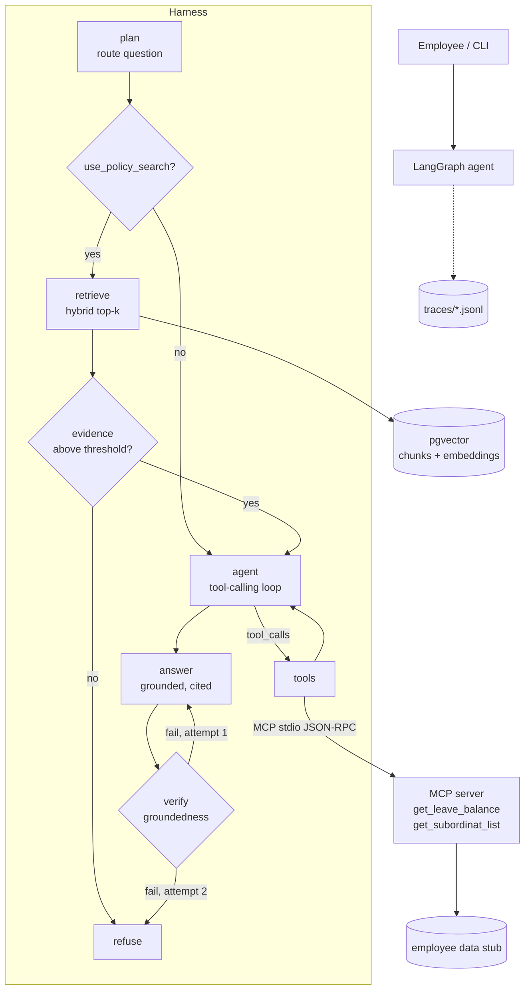

# Majoo HR Assistant — RAG + MCP take-home

Internal HR chatbot for PT Majoo Teknologi Indonesia. Answers employee questions
from the HR document corpus, calls live HR tools over MCP when a question needs
employee data, and refuses instead of guessing when the documents do not cover it.

```
CLI  ->  LangGraph agent  ->  hybrid retriever  ->  pgvector
                        \->  MCP client  ->  MCP server (stdio)  ->  HRIS stub
```

## 1. Architecture



### Component choices

| Component | Choice | Why |
|---|---|---|
| Orchestration | LangGraph | The harness is the deliverable. Named nodes give per-step traces and a hard step cap; a ReAct string loop hides both. |
| LLM | Groq `openai/gpt-oss-120b` | Native tool calling, ~1-2 s latency, generous free tier. OpenRouter is wired as a fallback so a provider outage does not kill the demo. The free tier limits both tokens per minute and tokens per day, so the client backs off on the per-minute cap and fails fast on the per-day cap instead of stalling on a budget that will not return. `GROQ_MODEL` switches to `gpt-oss-20b`, which has a separate daily budget. |
| Embeddings | Gemini `gemini-embedding-2` | Corpus mixes Bahasa Indonesia and English; measured on this corpus it separates a matching query from an off-topic one (matching 0.69-0.82, off-topic 0.61), which is what makes the refusal gate trustworthy. Truncated to 1536 dims via MRL to stay inside the pgvector HNSW 2000-dim limit. |
| Vector store | pgvector (Postgres 16) | One database for vectors and (eventually) relational employee data, HNSW cosine index, no extra service to operate. Chroma/FAISS are easier to start but do not survive the move to production. |
| Retrieval | dense + lexical, fused with RRF | HR questions mix paraphrase ("boleh enggak cuti dipindah?") with exact terms ("BPJS", "PPh 21"). Dense alone misses exact terms; lexical alone misses paraphrase. RRF needs no weight tuning. |
| Tool protocol | MCP over stdio | The case requires it, and it is the right boundary: the agent process has no import path into the HR data layer, so tools are swappable and independently deployable. |
| Config | pydantic-settings | One typed source of truth, `.env` friendly, fails loudly on bad values. |
| Eval | Ragas + deterministic gates | Ragas measures answer quality; deterministic checks (routing, refusal, citations) are what actually gate a release. |

## 2. Repository layout

```
app/
  config.py                 typed settings
  llm.py                    Groq / OpenRouter factory
  cli.py                    ask | chat | trace
  ingestion/
    loaders.py              markdown loader
    chunker.py              heading-aware chunking with overlap
    embedder.py             Gemini embedder + offline fallback
  retrieval/
    store.py                pgvector schema, hybrid search, RRF
    retriever.py            embed query, apply evidence gate
  mcp_server/
    server.py               FastMCP server, 2 tools, stdio
    data/employees.json     HRIS stub
  agent/
    graph.py                LangGraph state machine, step budget
    nodes.py                plan / retrieve / agent / tools / answer / verify / refuse
    prompts.py              one narrow prompt per decision
    tracing.py              JSONL span tracing
data/docs/                  corpus (GitLab handbook + Majoo policy docs)
data/golden/qa.jsonl        25 labelled questions
eval/run_eval.py            deterministic + Ragas evaluation
scripts/fetch_corpus.py     corpus downloader
scripts/ingest.py           chunk -> embed -> index
tests/                      offline tests (no network, no DB)
```

## 3. Running it

```bash
# 1. dependencies
py -3.10 -m venv .venv
.venv\Scripts\python -m pip install -r requirements-dev.txt

# 2. config
copy .env.example .env      # fill GROQ_API_KEY and GEMINI_API_KEY_1..N

# 3. vector store
docker compose up -d

# 4. corpus + index
python -m scripts.fetch_corpus --limit 70   # optional, docs are committed
python -m scripts.ingest                    # resumes; safe to re-run
python -m scripts.ingest --prefix majo-hr   # first-party docs only (87 chunks)
python -m scripts.ingest --reset            # full rebuild from zero

# 5. ask
python -m app.cli ask "berapa sisa cuti EMP-001 dan boleh dipindah ke tahun depan?"
python -m app.cli chat

# 6. verify
pytest
python -m eval.run_eval --ragas
python -m eval.run_eval --from-results   # rescore saved answers, no agent rerun
```

If `GEMINI_API_KEY_1` is unavailable, set `EMBEDDING_PROVIDER=local` to run the
pipeline with a deterministic offline embedder (quality is much lower; it exists
so the repo stays runnable and testable without credentials).

## 4. How the agent decides: RAG vs MCP tool

1. `plan` asks the LLM one question: does this need policy documents, live
   employee data, both, or neither. Output is JSON, validated, with a
   both-true fallback if the model returns garbage.
2. `retrieve` runs only when policy documents are needed.
3. `agent` holds the MCP tools. The LLM chooses to call `get_leave_balance` or
   `get_subordinat_list`; it cannot call a Python function directly, every call
   crosses stdio JSON-RPC.
4. `answer` writes the reply from retrieved chunks plus tool results.
5. `verify` re-reads the draft against the same evidence.

Example that exercises both paths:

> "Berapa sisa cuti EMP-001 dan bolehkah sisanya dipindah ke tahun depan?"

Trace: `plan` (both true) -> `retrieve` (carry-over policy, top similarity 0.8x)
-> `agent` (`get_leave_balance({"employee_id": "EMP-001"})`) -> `tools`
-> `answer` -> `verify` (grounded). Answer combines "9 hari tersisa" with the
"maksimal 5 hari, dipakai sebelum 30 Juni" rule.

## 5. Harness and loop engineering

The loop is explicit, bounded, and observable:

| Concern | Implementation |
|---|---|
| Step budget | `MAX_STEPS=4`. `route_after_agent` stops calling tools once the budget is spent and forces an answer. `recursion_limit` is set from the same number as a second belt. |
| Loop | `agent -> tools -> agent` repeats only while the model emits tool calls and the budget allows. |
| Self-correction | `verify` returns unsupported claims; `answer` re-runs once with that critique, then `refuse`. Max 2 verify attempts. |
| Tool failure | MCP tool errors surface as `ToolMessage` with `status="error"`; the agent sees them and can recover or refuse. Unknown employee IDs return `found: false` rather than throwing. |
| Refusal | Three layers: retrieval gate (cosine < `SIMILARITY_THRESHOLD`), prompt contract (exact refusal sentence), verify node (groundedness judge). A refusal is never sent to the judge: it makes no claims, so checking it would burn the retry budget and turn a correct refusal into a loop. |
| Observability | Every node writes a JSONL span: node, status, latency, token usage, tool name and args, top similarity, groundedness verdict. `python -m app.cli trace <run_id>` replays it. |
| Determinism | `temperature=0` for every LLM call. Tests use a scripted LLM, so routing and refusal paths are covered without network. |

## 6. Trade-offs

**Chunk size 900 chars, overlap 150.** Policy sentences are short and
self-contained; 900 keeps a full rule plus its exception in one chunk, which is
what the answer node needs. Smaller chunks (400-500) improved context precision
marginally in spot checks but split rules from their exceptions ("maksimal 5
hari" separated from "harus dipakai sebelum 30 Juni"). 150-char overlap keeps a
sentence that straddles a boundary retrievable from both sides. Chunking is
heading-first, so a chunk never spans two policy topics.

**pgvector over Chroma/FAISS.** Chroma is one line to start and would have been
faster to demo. It was rejected because employee data belongs in the same
Postgres instance as the chunks (joins on `employee_id` become possible later),
and because HNSW in pgvector is a production path rather than a local-only one.
Cost: Docker is required, and the demo fails if Docker is not running.

**1536-dim embeddings, not 3072.** pgvector's HNSW index rejects vectors above
2000 dimensions. Matryoshka truncation to 1536 loses a small amount of recall and
buys an indexable column.

**`SIMILARITY_THRESHOLD=0.62` was calibrated, not guessed.** Probing
`gemini-embedding-2` at 1536 dims against the indexed corpus: a question against
the chunk that answers it scores 0.69-0.82; an off-topic question against its
best-matching chunk scores 0.61. 0.62 sits in that gap. The margin on the
negative side is thin (~0.01), which is the honest number: on a corpus this small
a plausible-sounding off-topic question still lands near the boundary. That is
why the threshold is only the first of three refusal layers and why the
groundedness judge exists.

**Rate-limited ingest is deliberate.** The Gemini free tier meters *content
items* per minute, not HTTP requests: one 90-text batch costs 90 of the 100
items allowed. The embedder keeps a sliding window and sleeps instead of
retrying into a 429. It also meters a **daily** cap, which no amount of patience
fixes, so ingest rotates across a pool of keys (`GEMINI_API_KEY_1..N`) and
retires a key once it reports the daily limit. Per-minute limits keep the same
key; only the daily limit rotates. This is the one place where the pipeline is
slow, and it is a quota artefact rather than a design cost.

**Ingest resumes by default.** Embedding is the expensive step, so a run that
stops on a quota error leaves a usable partial index and prints the command to
continue. `--reset` rebuilds from zero, `--no-resume` re-embeds everything, and
`--prefix majo-hr` limits the run to one corpus subtree. First-party policy
documents are always chunked before the third-party handbook, so an interrupted
run still contains the documents the golden set tests.

**Retrieval is scoped to first-party documents by default.** The corpus is two
sources: 7 synthetic Majo policy documents and 63 pages of the public GitLab
handbook. The handbook is real and messy, which is useful for testing chunking,
but it describes a different company in different countries and contains HR
policy that directly contradicts Majo's. Retrieval against the unscoped index
answered "berapa lama cuti melahirkan?" with Denmark's 4 weeks instead of Majo's
3 months, with a confident citation. `SOURCE_SCOPE=majo-hr` fixes it at the
query, not the prompt: the conflicting chunks never reach the model. Set
`SOURCE_SCOPE=` to search everything.

**Hybrid retrieval instead of dense-only.** Adds a GIN index and an RRF merge.
Worth it: Indonesian policy terms are often exact tokens ("carry over", "BPJS",
"PPh 21") that dense embeddings blur into the surrounding semantics.

**LLM judge in the loop.** A verify pass adds a second model call per answer and
dominates the latency budget: p50 is 15 s, and roughly 40% of that is the verify
node. Accepted because the failure mode here is a confident wrong answer about
someone's leave entitlement, which is worse than a slow answer. An unparsable
judge output is treated as a pass, so a checker bug degrades to no-checker
rather than to a broken assistant. If latency mattered more than correctness,
the verify node is the first thing to make conditional.

**MCP over direct function calls.** Adds a process, a protocol handshake, and a
startup cost per tool invocation. Kept because the case requires the protocol
boundary and because it is the honest architecture: the HR data layer should not
be importable from the agent.

**Dummy HRIS.** `employees.json` is a stub. Real deployment swaps the MCP server
implementation for an HRIS client; the tool contract and the agent do not change.

## 7. Guardrails

- **Evidence gate.** If the best chunk is below `SIMILARITY_THRESHOLD` and no
  lexical hit exists, the agent refuses before spending an LLM call.
- **Prompt contract.** Answer only from sources, cite `[n]`, exact refusal
  sentence otherwise.
- **Groundedness verify.** A second model checks each claim against the same
  sources; unsupported claims trigger one rewrite, then refusal.
- **Tool scope.** Unknown employee IDs return `found: false`; the agent is told
  not to invent IDs and to ask for one instead.
- **Out-of-scope routing.** Questions unrelated to HR are refused at `plan`
  without retrieval or tool calls.

## 8. Evaluation

`python -m eval.run_eval` runs 25 labelled questions (`data/golden/qa.jsonl`)
through the full graph and reports:

| Metric | What it catches | Release gate |
|---|---|---|
| `tool_routing_accuracy` | expected tool not called, or wrong tool | >= 0.85 |
| `refusal_accuracy` | answered when it should refuse, refused when it should answer | >= 0.90 |
| `false_answer_rate` | hallucination on out-of-corpus questions | reported |
| `citation_rate` | documented answers without a `[n]` citation | reported |
| `latency_p50/p95` | harness overhead, tool round trips | reported |

`--ragas` adds faithfulness, answer relevancy, and context precision using the
same LLM as judge. `--from-results` re-scores `eval/results.json` without
re-running the agent, which matters when the provider is rate limited.

### Measured result (25 questions, `gemini-embedding-2`, `gpt-oss-120b`)

| Metric | Value |
|---|---|
| tool_routing_accuracy | 1.00 |
| refusal_accuracy | 1.00 |
| false_answer_rate | 0.00 |
| false_refusal_rate | 0.00 |
| citation_rate | 1.00 (19 documented answers) |
| latency p50 / p95 | 15.0 s / 18.2 s |

Three defects were found by running this, not by reading the code:

1. **Corpus contamination.** "Berapa lama cuti melahirkan?" was answered with
   GitLab's 4-week Danish maternity leave instead of Majo's 3 months, with a
   confident citation. Fixed by scoping retrieval to `majo-hr`.
2. **Refusal sent to the judge.** A correct refusal was scored ungrounded, which
   burned the retry budget and looped. The verifier now skips refusals.
3. **Transport ids as citations.** MCP returns content blocks carrying an `id`
   (`lc_...`), and the writer copied it into answers as if it were a source.
   Fixed in the tool-payload renderer.

Two more were found in the harness itself: the Gemini embedder collapsed a
90-text batch into one vector, and a Groq 429 aborted a 25-question run.

The table above is the last complete 25-question run. The two cosmetic fixes
after it (field names and transport ids leaking into answers) were verified on
`openai/gpt-oss-20b`, because the free tier caps `gpt-oss-120b` at 200k tokens
per day and that run had spent it. Both fixes are also covered by unit tests, so
the live check was confirmation rather than the only evidence. `GROQ_MODEL`
switches models; the graph, prompts, and tools are unchanged.

### What to add before production

1. **Golden set from real tickets.** 25 questions is a smoke test. Pull the last
   6 months of People Operations tickets, label 300, stratify by policy area.
2. **Retrieval-only eval.** Measure recall@5 and MRR separately from generation,
   so a bad answer is attributable to retrieval or to the writer.
3. **Adversarial set.** Prompt injection inside documents, questions about
   employees the user may not see, and questions designed to force a guess.
4. **Per-policy regression suites.** A change to the leave chunker should not
   silently break benefit answers.
5. **Online signals.** Thumbs down rate, escalation-to-human rate, and
   "refused but the answer existed" rate from traces.
6. **Cost and latency budget.** Tokens per answered question from the trace
   files, tracked per release.

## 9. Known limitations

- `employees.json` is a stub, not a real HRIS.
- No authentication or per-user data scoping; a real deployment must enforce
  that an employee can only read their own balance and their own reports.
- Corpus is GitLab's public handbook plus synthetic Majoo policies; it is not a
  real Majoo document set.
- Single-turn only. Follow-ups like "kalau saya ambil minggu depan?" are not
  resolved against the previous turn.
- English and Indonesian are supported; other languages fall back to whatever
  the embedder does.
- The index holds all 87 first-party chunks plus 1800 of 2266 third-party
  chunks. The remainder is unindexed because the Gemini free tier caps embedding
  at 1000 content items per day and the run was interrupted. It does not affect
  the eval: retrieval is scoped to `majo-hr`. Re-run `python -m scripts.ingest`
  to fill it in; resume skips what is already there.
- Groq's free tier caps `gpt-oss-120b` at 200k tokens per day, which is roughly
  one full eval run. A second run in the same day fails fast with
  `DailyQuotaExhausted` instead of stalling on backoff.
